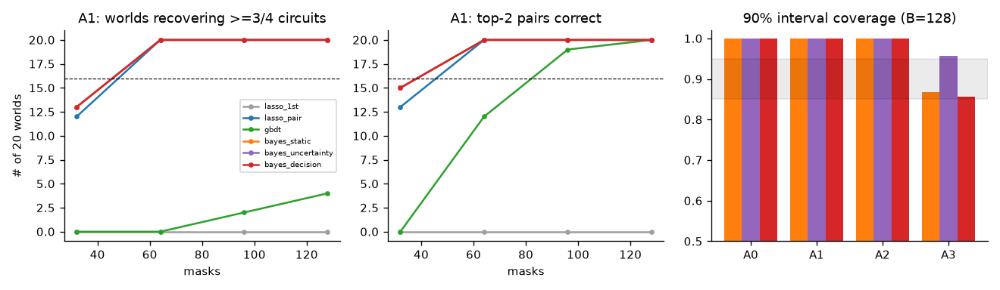
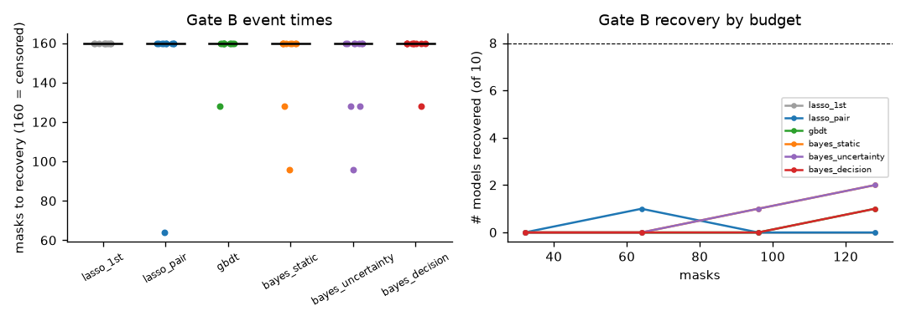
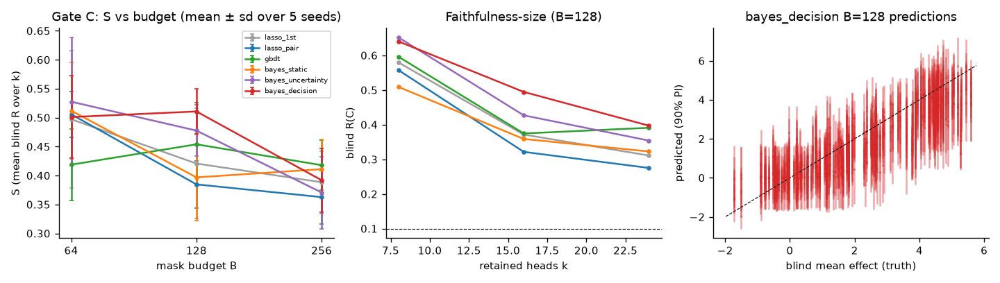
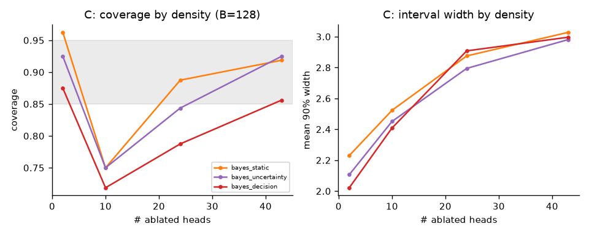
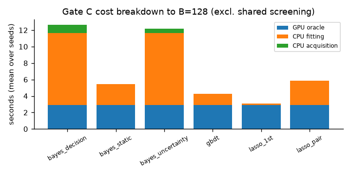

# Bayesian Causal Circuit Discovery — Go/No-Go Pilot Report

**Date (UTC):** 2026-10-18T22:33:38Z  
**Protocol:** BCCD-PILOT-1.0 (protocol doc SHA-256 `fe2a3d4f77aaa69f2684267c54980119524e99c8f9a04db456f4d325f9d57986`; config SHA-256 `c2102e71fc7e1cfe2b922103bb5e4c35f643dc2e6b5b1a6a48132453782890ec`)  
**Git revision / uv lock:** `f1efd9912521e4a86f89898511b5096e1cdeea85` (dirty=True) / `f05cad05dc522932c1a36df061d6970970852bb48f1162bd2769de8284a6a759`  
**Host / GPU / driver / torch:** Linux-7.0.0-15-generic-x86_64-with-glibc2.43 / NVIDIA RTX A4000, 595.71.05, 16376 MiB, 4 MiB / torch 2.8.0+cu126 (CUDA build 12.6)  
**Overall verdict:** **NO_GO** (Gate A FAIL, Gate B FAIL, Gate C FAIL)  
**MLflow tracking:** remote `http://127.0.0.1:5001` via SSH tunnel; parent runs {"gate_a_parent": "d6ebe797a95d48c0ba72674736cdfb36", "gate_b_parent": "221e31a4735542b6bdf8320d6a947b7f", "gate_c_parent": "c8c20c5ea1804702a85b57b49552c364", "gate_c_prepare_parent": "69acae6453904987aa681553f90bf9fc", "gate_a_dev_parent": "3c2a5918fca143269f369ee682219ab2"}

**Run-time provenance per gate** (each gate's summary records the code revision it actually ran with):

| Gate | git SHA at run | dirty | impl-config SHA-256 | uv.lock SHA-256 | parent MLflow run |
|---|---|---|---|---|---|
| A | `165805538ba41139336cc17563c8d4f14568f913` | False | `7e48e9b5eadb4d72…` | `f05cad05dc522932…` | `d6ebe797a95d48c0ba72674736cdfb36` |
| B | `f8b232f2d88a538711561ec7981104f569df1c4a` | False | `7e48e9b5eadb4d72…` | `f05cad05dc522932…` | `221e31a4735542b6bdf8320d6a947b7f` |
| C | `6b43b7f37a19c2d1729f21b4d1ebc7c72fe5076b` | False | `177e80fcf1f24483…` | `f05cad05dc522932…` | `c8c20c5ea1804702a85b57b49552c364` |

## Executive decision

**Formal verdict: NO_GO.** All three pre-registered gates were implemented and executed in full on the remote
RTX A4000 host, and **each gate fails at least one mandatory condition** (Gate A: A-4; Gate B: B-1–B-4;
Gate C: C-1–C-5). No smoke run, exploratory run or diagnostic contributes to any verdict.

- **Gate A (synthetic, 80 worlds):** planted pairs and all four alternative minimal circuits are recovered in
  20/20 A1 worlds, and the misspecification detector is perfect (20/20, 0/60 false alarms). However, 90%
  predictive intervals cover **100%** of blind targets on A0–A2 (they are ~100× wider than the errors), so A-4
  fails. Pairwise Lasso is just as successful at a small fraction of the cost.
- **Gate B (10 valid planted XOR transformers):** the decision-focused Bayesian method recovers ≥3/4 planted
  circuits in **1/10** models by B=128; all medians are censored; **78/84** high-confidence circuit claims
  were wrong.
- **Gate C (GPT-2 Small IOI, 5 seeds):** at B=128, Bayesian decision-focused **S = 0.511** vs strongest
  non-Bayesian (pairwise Lasso) **S = 0.385**, i.e. **33% worse** (needed ≥15% better). Pairwise Lasso at
  B=256 reaches 0.363. Paired hierarchical-bootstrap 90% CI for S_ref − S_Bayes is **[−0.170, −0.076]**.
  Coverage of nominal 90% intervals is **0.809** (mean width 2.58 on targets with SD 1.95). End-to-end
  compute is 2.20× that of the comparator. No method found any circuit with R ≤ 0.10 at k ≤ 24.

**Recommendation:** stop this formulation (sparse pairwise Bayesian surrogate + decision-focused acquisition)
as a top-tier research direction. Section 9 describes narrower pivots that the evidence leaves open.

| Gate | Criteria | Verdict |
|---|---|---|
| A | A-1 PASS · A-2 PASS · A-3 PASS (zero-error fallback only) · **A-4 FAIL** · A-5 PASS | **FAIL** |
| B | **B-1 FAIL · B-2 FAIL · B-3 FAIL · B-4 FAIL** (benchmark construction valid: 10/10) | **FAIL** |
| C | **C-1 FAIL · C-2 FAIL · C-3 FAIL · C-4 FAIL · C-5 FAIL** (candidate pool valid: 4.56 ≥ 0.5) | **FAIL** |

## 1. Environment and reproducibility

| Property | Observed value |
|---|---|
| GPU and VRAM | NVIDIA RTX A4000, 16 376 MiB (single GPU); 8-core AMD EPYC-Milan; 31 GiB RAM; Ubuntu 26.04 (kernel 7.0.0-15) |
| NVIDIA driver / torch CUDA build | driver 595.71.05 (reports CUDA 13.2) / torch 2.8.0+cu126 (explicit uv index `pytorch-cu126`) |
| Python / uv / PyTorch / TransformerLens / MLflow | 3.11.13 / 0.7.12 / 2.8.0 / 2.15.4 (transformers 4.57.6) / 3.17.1 |
| Other key packages | numpy 2.2.6, scikit-learn 1.9.1, LightGBM 4.7.0, shapiq 1.4.1 (official `ProxySPEX`) |
| Git at run time | Gate A `1658055`, Gate B `f8b232f`, Gate C `6b43b7f` (all clean worktrees; see **D-PROV-1** below) |
| uv.lock / protocol / config SHA-256 | `f05cad05…a759` / `fe2a3d4f…6f84` / `c2102e71…890ec` (unchanged throughout) |
| External data / models | MIB IOI `mib-bench/ioi@e5f3468f3af4c0883be35cd3bced8c711c95d286`; GPT-2 `gpt2@607a30d783dfa663caf39e06633721c8d4cfcd7e` (weights SHA-256 `2c06fd4a…2933`, MIT) |
| Third-party code | none cloned or vendored; MIB EAP-IG replaced by an in-repo node-level replica (D-C-2); Bair et al. not run (optional) |
| MLflow experiments (remote, 127.0.0.1:5001) | `bccd/gate-a` (id 4; 481 runs), `bccd/gate-b` (id 5; 61), `bccd/gate-c` (id 6; 32), `bccd/aggregate` (id 3), `bccd/gate-a-dev` (id 2), `bccd/dev-smoke` (id 1); all runs FINISHED |
| Parent runs | Gate A `d6ebe797a95d48c0ba72674736cdfb36`; Gate B `221e31a4735542b6bdf8320d6a947b7f`; Gate C `c8c20c5ea1804702a85b57b49552c364`; Gate C freeze `69acae6453904987aa681553f90bf9fc`; Gate A dev threshold `3c2a5918fca143269f369ee682219ab2`; diagnostics `fdb531ee26884cbf9c00dacefe554dea` (ProxySPEX), `6ff16facba4d471ba59cafa6b4683741` (transfer), `b55eed3821b44d569221f0e649ad8420` (replication) |

**Operations.** Code was developed locally, committed, and rsynced (with `.git`) to `/root/work/bayesian-circuit-poc`
on the host. MLflow ran in tmux `bccd-mlflow` (SQLite `mlruns/mlflow.db`, artifacts `mlruns/artifacts`), bound
to **127.0.0.1:5001**; port 5000 already belonged to another project's MLflow, which was not touched (D-INF-1).
No firewall or host-level changes were made. Each gate ran in its own tmux session through
`scripts/run_gate.sh` (pipefail, `logs/<cmd>.log`, `.status.json`, `.exit.json`); GPU gates ran serially.
An artifact round trip was verified before confirmatory runs (run `e9ce02a4bd0f42e7a4f307badbd55a19`) and again
afterwards on a Gate C child run. No run failed, crashed or hit OOM (peak allocated VRAM 1 341 MiB in Gate C discovery,
1 791 MiB in EAP-IG screening). Confirmatory commands refuse dirty worktrees; one launch of Gate A was correctly
refused for that reason before the real launch.

**Reproducibility audit.** After all gates finished, one unit per gate was re-executed from the committed code
(`diagnostics --which replicate`): Gate A worlds A0-1001, A1-2001 and A3-4001 and Gate B model 20000 reproduce
every logged metric bit-for-bit for all six methods and checkpoints, and Gate C seed 31001 reproduces all 18
sealed circuit decisions exactly (`runs/diagnostics/replication.json`).

## 2. Method summary

- **Semantics.** `m_j = 1` ablates candidate j. Gates B/C zero the head's `blocks.{l}.attn.hook_z` at **all
  token positions** through multiplicative hooks (tested: only the intended head slice changes; joint masks act
  as unions and are independent of index order; retain(C) touches only the candidate pool; d(x,0) = 0).
  `d(x,m) = s(F(x)) − s(F^do(m)(x))` always comes from running the real frozen model (or, in Gate A, the
  synthetic world). Gate C scores the IO−S logit difference exactly from the final normalised residual
  restricted to the two answer tokens (matches full logits to 2×10⁻⁴).
- **Bayesian model.** Main + all-pairs (+ context × feature for A2) spike-and-slab regression, no intercept, no
  heredity. Conjugate slab β ~ N(0, σ²τ²), τ = 5; σ² ~ IG(1, 10⁻⁴) on the RMS-scaled response; separate
  Beta(1,1) beta-binomial support priors for each feature group. Supports are sampled by a collapsed
  Metropolis–Hastings sampler with informed single-flip proposals using Barker balancing, plus informed swap
  moves. Two chains run (empty start and greedy-MAP start; warm-started across active rounds), giving 200
  particles; β and σ² are drawn exactly from their conditionals. The sampler agrees with exact enumeration over
  all 1 024 supports at p = 4 to within 0.01 in inclusion probability (unit test tolerance 0.03). An initial sqrt-balanced
  proposal stalled on noiseless data and was replaced *before* any gate ran.
- **Targets.** Gate A: d(m) (A2: one target per context group). Gates B/C: the batch mean of |d(x,m)|, i.e. the
  numerator of R, so that every surrogate predicts R directly. Gate C calibration (C-3) uses a separately
  fitted signed-effect model for each method plus a prompt-resampling variance term (D-C-3).
- **Circuit search (shared by all surrogates).** Gates A/B: exact enumeration of circuits of size ≤ 3 / ≤ 2.
  Up to 4 minimal-size proposals: non-Bayes by R̂ ≤ 0.10; Bayes by P(R ≤ 0.10 | D) ≥ 0.5. Gate C: greedy
  backward elimination + best-improvement swaps for k ∈ {8, 16, 24}, minimising R̂ (non-Bayes) or the posterior
  expected R (Bayes).
- **Acquisition.** Warm start: 32 balanced-density masks shared by all methods. Static methods (`lasso_1st`,
  `lasso_pair`, `gbdt`, `bayes_static`) use one fixed seeded mask sequence. Active methods choose batches of 16
  from a 128-mask pool (64 random balanced + 64 retain-circuit tests and one-edit neighbours of the 20-circuit
  shortlist). `bayes_uncertainty` greedily maximises fantasised posterior function variance;
  `bayes_decision` greedily maximises the expected reduction of V(D) = min_C E[L(C;θ)|D], with
  L = |C|/p + 10·max(R − 0.1, 0), via importance re-weighting of 32 posterior particles under
  "particle-as-truth" fantasies. This is the **full** decision-value criterion, approximated with particles and
  shortlists — not a disagreement heuristic. Equal mask costs; ties broken randomly with a fixed seed.
- **Baselines.** LassoCV on RMS-scaled main features and on main + all-pairs features (the same pair dictionary
  as the Bayesian model), with 5-fold CV on discovery data; LightGBM with 4-fold CV over a fixed 4-configuration
  grid on discovery data; official `shapiq.ProxySPEX` (FBII, its own 128 coalitions) as an
  interaction-attribution diagnostic only.
- **A2 context modelling** was implemented (context × feature interactions). The **A3 misfit rule** (4-fold CV
  RMSE / RMS response > t) and its threshold t = 0.0162 were frozen from development worlds before
  confirmatory runs (D-A-3).

## 3. Gate A — Controlled causal worlds (CPU, 80 confirmatory worlds, 0 failed runs)

All six methods were run on 20 confirmatory worlds per regime (A0–A3; seeds 1001–4020) with the shared 32-mask
warm start, checkpoints 32/64/96/128 and 256 blind masks per world. Ground truth was held only by the world
object; discovery code received a budget-accounted oracle. The A3 misfit threshold (t = 0.0162) was frozen from
16 development worlds by the pre-declared rule D-A-3 before any confirmatory world ran.

| Criterion | Observed (bayes_decision, B=128) | Status |
|---|---|---|
| A-1 | top-2 nonadditivity pairs correct in 20/20 A1 worlds (Wilson 95% [0.84, 1.00]) | PASS |
| A-2 | ≥3/4 exact minimal size-3 circuits in 20/20 A1 worlds; 0 invalid P≥0.95 claims at any checkpoint | PASS |
| A-3 | A0 MAE 0.00093 vs first-order Lasso 0.00018 (**raw ratio 5.2×**); passes only through the pre-declared zero-error fallback (normalised MAE 0.0014 ≤ 0.01) | PASS (fallback) |
| A-4 | pooled A0–A2 coverage **1.000** (A0 1.000, A1 1.000, A2 1.000); mean 90% width ≈ 0.08–0.09 vs MAE ≈ 0.0005–0.0009 | **FAIL** |
| A-5 | A3 coverage 0.857 (in [0.85, 0.95]); detector flagged 20/20 A3 worlds with 0/60 false positives | PASS |

**Gate A verdict: FAIL (A-4).** The Bayesian posterior predictive intervals are grossly over-conservative on the
deterministic, exactly-representable regimes: intervals are ~100× wider than the actual errors, so every blind
target is covered. The cause is structural, not a sampler bug: with the conjugate slab
β ~ N(0, σ²τ²), the marginal posterior of σ² includes the ridge term ||β||²/τ², which places a noise floor of
roughly ||β||/(τ√n) on noiseless data. Tuning τ on development worlds to hit 90% coverage would have meant
calibrating to an artefact, so τ was left at its pre-set value (5.0).

**What Gate A does and does not show.** Pairwise Lasso is equally successful on the planted quadratic
mechanisms: it recovers ≥3/4 circuits in 12/20 A1 worlds at B=32 (Bayes: 13/20) and 20/20 from B=64 on, with
top-2 pairs correct in 20/20 worlds, at ~0.2 s CPU per world versus ~6 s for `bayes_decision`. On A1 the
decision-focused, uncertainty and static Bayesian variants are indistinguishable (all 20/20 from B=64). Gate A
therefore provides no evidence of a Bayesian or active-learning advantage; it does confirm that the
implementation recovers planted interactions without heredity and that the CV-based misfit detector separates
A3 from A0–A2 cleanly.

## 4. Gate B — Planted redundant XOR transformers (GPU)

**Construction.** Direct-weight TransformerLens models (3 layers × 8 heads, d_model = 64, d_head = 8, d_mlp = 32,
ReLU, no LayerNorm). Two redundant A heads and two redundant B heads, placed at random among the 16 heads of
layers 0–1, copy the bit signs from positions 0/1 to the query position; MLP1 saturates each sum to {−1, 0, +1};
MLP2 computes the XOR margin; 20 nuisance heads act in a separate residual subspace with a small calibrated
read-out (1–4% of the margin scale). Ten candidates (seeds 20000–20009) were built and **all 10 passed every
validity check on 256 independent inputs** (10 attempts, 0 rejections): clean accuracy 1.00; accuracy with any
single relevant head ablated 1.00; with either full redundant pair ablated 0.50; singleton/pair margin-effect
ratio 0.0. Among all 300 retained circuits of size ≤ 2, exactly the four planted A×B circuits are faithful
(worst planted R per model 0.010–0.045). Ablating either pair drops accuracy to chance, which verifies that
there is no residual/MLP bypass.

| Criterion | Observed | Status |
|---|---|---|
| B-1 | `bayes_decision` recovered ≥3/4 planted circuits with a blind-faithful proposal in **1/10** models by B=128 | **FAIL** |
| B-2 | median masks-to-recovery 160 (censored) vs best non-Bayesian 160 → ratio 1.00 | **FAIL** |
| B-3 | median 160 vs `bayes_static` 160 → ratio 1.00 | **FAIL** |
| B-4 | **78 of 84** high-confidence (P ≥ 0.95) claims were invalid on blind inputs (78 at B=32) | **FAIL** |

Successes by B=128 (of 10): bayes_static 2, bayes_uncertainty 2, bayes_decision 1, gbdt 1, lasso_pair 0
(1 at B=64, then lost), lasso_1st 0. Most event times are censored for every method, so no speed-up can be
claimed either way.

**Gate B verdict: FAIL (B-1–B-4).**

**Failure analysis.**
1. *The benchmark's response is not pairwise.* Removing either redundant pathway destroys XOR, and removing
   both does not destroy it "more". The intervention response is therefore close to κ·OR(AND(A₁,A₂), AND(B₁,B₂))
   = κ(m_{A1}m_{A2} + m_{B1}m_{B2} − m_{A1}m_{A2}m_{B1}m_{B2}), which contains a 4th-order term that no main+pairwise
   surrogate can represent. This is intrinsic to redundant-pathway XOR measured on a task margin, not a feature
   of this particular construction.
2. *Finding the interacting pairs is easy; turning them into faithful circuits is not.* Official
   `shapiq.ProxySPEX` (FBII, its own 128 uniformly-sampled coalitions) placed the two planted pairs as its top-2
   order-2 interactions in **10/10** models, as did pairwise Lasso, GBDT and `bayes_uncertainty` (10/10 at
   B=128). `bayes_decision` did so in only 3/10, since its circuit-test masks carry little information about
   global interaction structure. Under the misspecified surrogate, predicted R(C) for the true circuits is
   inaccurate, so proposals are wrong or absent.
3. *Overconfidence.* The invalid high-confidence claims are concentrated in two models (20004: 17, 20006: 61) at
   the shared 32-mask warm start (identical for the three Bayesian variants). Across all Bayesian snapshots
   (three variants × 4 checkpoints × 10 models), 204 of the 255 invalid claims came from snapshots where the two
   MCMC chains broadly agreed (max between-chain inclusion-probability difference ≤ 0.5). This is therefore
   posterior overconfidence under misspecification at small n, not only poor mixing. (Post-hoc observation,
   not used to change any rule.)

## 5. Gate C — GPT-2 Small IOI (GPU, 5 seeds)

**Frozen setup (run `69acae6453904987aa681553f90bf9fc`, before any discovery).** GPT-2 Small
(`gpt2@607a30d7…`, fp32, TransformerLens `from_pretrained_no_processing`). MIB IOI prompts: screening 64 and
discovery 5×32 from MIB *train*; development discovery 32 (train) and development evaluation 64 from MIB *dev*;
**blind 128 from MIB *test*, spanning 9 template families, none of which appear in any discovery prompt**. No
prompt was excluded (all names are single tokens; ABC counterfactuals match in length). Screening used the
node-level EAP-IG replica (ABC counterfactual, 5 IG steps, 448 forward + 320 backward evaluations, 1.5 s).
The top-32 heads contain the canonical IOI heads: name movers 9.6/9.9/10.0, backup name movers 9.7/10.1/10.6/
10.10/11.2, negative name movers 10.7/11.10, S-inhibition 7.3/7.9/8.6/8.10, induction 5.5/6.9 and
duplicate-token 0.1/3.0. Added to these were 16 seeded random heads (pool SHA-256 `25568c18…`). **Pool validity:**
ablating all 48 changes the logit difference by 4.56 on average on the screening prompts (clean 3.76; ≥0.5
required). Blind masks: 32 at each of 2/10/24/43 ablated heads. Development-preselected C-4 reference:
`lasso_pair` (development S 0.340 vs gbdt 0.347 vs lasso_1st 0.372).

| Criterion | Observed | Status |
|---|---|---|
| C-1 | S_Bayes(128) = 0.511 vs best non-Bayes (lasso_pair) 0.385 → ratio **1.33** (need ≤ 0.85); per-seed gains −60%, −5%, −39%, −58%, −34% (0/5 ≥ 15%) | **FAIL** |
| C-2 | S_Bayes(128) = 0.511 vs lasso_pair S(256) = 0.363 | **FAIL** |
| C-3 | coverage **0.809**; by #ablated 2: 0.88, 10: 0.72, 24: 0.79, 43: 0.86; mean width 2.58 (blind-target SD 1.95); CRPS 0.558; without the prompt-resampling term coverage would have been 0.739 | **FAIL** |
| C-4 | paired hierarchical bootstrap (2 000 reps; seeds, then template families, then prompts) 90% CI of S_ref − S_Bayes = **[−0.170, −0.076]**; relative [−48%, −18%] | **FAIL** |
| C-5 | end-to-end wall at B=128 incl. 1.5 s screening: 14.4 s vs 6.5 s → **2.20×** (GPU oracle ≈ 2.9 s each = 4 096 forward passes; Bayes CPU fitting 8.7 s + acquisition 1.0 s) | **FAIL** |

**Gate C verdict: FAIL (C-1–C-5).** Every criterion fails, and C-1/C-2/C-4 fail in the *opposite* direction
from the hypothesis: the decision-focused Bayesian method selects significantly less faithful circuits than
pairwise Lasso at the same budget. Pooled S at B = 64/128/256: lasso_1st 0.497/0.421/0.389, lasso_pair
0.506/0.385/0.363, gbdt 0.419/0.454/0.418, bayes_static 0.512/0.397/0.411, bayes_uncertainty
0.528/0.478/0.371, bayes_decision 0.501/0.511/0.392. **No circuit from any method, seed, budget or k reached
the absolute R ≤ 0.10 criterion** (minimum blind R = 0.19, lasso_pair, k = 24, B = 256). Held-out MAE for the
signed mean effect at B = 128: bayes_decision 0.786, bayes_static 0.707, bayes_uncertainty 0.702, gbdt 0.693,
lasso_1st 0.739, lasso_pair 0.786. The Bayesian ablations are better calibrated than the candidate method
(bayes_static 0.880, bayes_uncertainty 0.861 coverage at B = 128), but they are not the candidate and do not
pass C-1/C-2 either.

**Failure analysis (exploratory diagnostics, after all verdicts were fixed).**
1. *It is not prompt/template shift.* Re-measuring every sealed circuit's R on its own 32 discovery prompts
   gives values that track blind R closely (correlation 0.86) and are, if anything, slightly higher
   (`runs/diagnostics/gate_c_discovery_vs_blind_R.csv`).
2. *It is surrogate optimism under search (winner's curse).* Averaged over seeds and k, all surrogates predict
   R of 0.10–0.28 for their own selected circuits but measure 0.43–0.59 on the very prompts they were fit to. `bayes_decision` is the most optimistic: at B=128 it predicts
   R = 0.104, measures 0.559 on discovery prompts and 0.511 blind. Its posterior probabilities are miscalibrated
   at the circuit level. Example: seed 31001, k = 24, P(R ≤ 0.10) = 0.805, blind R = 0.507. Across all
   selected circuits P reached 0.925, though none crossed the 0.95 claim threshold. Decision-focused acquisition
   spends its masks around the posterior's current favourite circuits, so it repeatedly finds new regions where
   the quadratic surrogate is over-optimistic. At B = 128 it is worse than its own static ablation
   (0.511 vs 0.397); at B = 256 it is roughly level (0.392 vs 0.411).
3. *Interaction structure is not stably identified at this budget.* Official ProxySPEX's top pairwise
   interactions differ across the five seeds and do not overlap the Bayesian posterior's top pair features
   (`runs/diagnostics/proxyspex.json`).

## 6. Ablations and scientific interpretation

- **Is Bayesian sparsity useful (bayes_static vs lasso_pair)?** No measurable benefit. In A1 both recover all
  circuits from B = 64. In Gate B, bayes_static gets 2/10 vs 0/10, but nearly everything is censored. In
  Gate C, S(128) is 0.397 vs 0.385 and S(256) is 0.411 vs 0.363. The Bayesian fit costs more.
- **Does active selection save interventions?** No. In Gate A the static and active variants are
  indistinguishable. In Gate B, decision gets 1/10 and uncertainty 2/10 vs static 2/10. In Gate C, decision is
  worse than static at B = 128 and comparable at 256.
- **Decision-focused vs variance-based?** Decision-focused is never better. In Gate C it is worse at 128
  (0.511 vs 0.478) and 256 (0.392 vs 0.371). In Gate B its pair retrieval is much worse (3/10 vs 10/10)
  because circuit-test masks carry little global information.
- **Are the interactions accessible more cheaply?** Yes. Official ProxySPEX with 128 own coalitions retrieves
  the planted pairs in 10/10 Gate B models and 18/20 A1 worlds; pairwise Lasso and GBDT reach 10/10 in Gate B
  and pairwise Lasso 20/20 in A1, at a fraction of the Bayesian CPU cost.
- **Robust or only winning on its own assumptions?** On the regimes that match the model (A0–A2) every
  pairwise method succeeds, and the Bayesian intervals are badly over-conservative. Misspecification is
  detected in A3. It is not survived in Gate B (4th-order OR structure) or Gate C (real model).
- **Are alternative minimal circuits distinguishable?** In A1, yes: all four are recovered by every pairwise
  method. In Gate B they are distinguishable by circuit tests in principle, but the misspecified posterior did
  not resolve them within 128 masks. In Gate C no circuit of size ≤ 24 is faithful, so the question of
  alternative faithful circuits does not arise at these sizes.

## 7. Mandatory Go/No-Go matrix

The full matrix, recomputed by `report` from the saved artifacts (not copied from run-time summaries), is at
the end of this document. It agrees with the run-time summaries for all 14 criteria.

## 8. Caveats, deviations and confidence

All deviations are in `docs/07_DECISIONS_AND_DEVIATIONS.md`. Operational specifications D-INF-1, D-ENV-1,
D-A-1…6, D-B-1 and D-C-1…5 were fixed before any confirmatory run; D-C-6 (Lasso tolerance for Gate C) was set
before any Gate C run; D-PROV-1 (see below) was found after all gates ran. No threshold, seed, split or
budget was changed, and no run was excluded or repeated.

- **D-PROV-1 (provenance defect, no effect on results).** An unanchored `.gitignore` pattern `models/` kept
  `src/bayescircuits/models/` out of git during the runs. The files were deployed and executed, but they were
  not part of the run-time SHAs. The package is now committed, file timestamps establish which version each
  gate ran, and the deterministic replication audit (Section 1) reproduces the confirmatory outputs exactly
  from the committed code.
- **A-3** passes only through the pre-declared zero-error fallback. The raw Bayesian/Lasso MAE ratio on A0 is
  5.2×, because slab shrinkage and coefficient sampling add ~10⁻³ error where first-order Lasso is ~2×10⁻⁴.
- **A-4** is partly a property of the criterion: with deterministic, exactly representable oracles even an
  ideal posterior would over-cover. Our intervals are, however, ~100× wider than the errors because of the
  conjugate noise floor. τ was fixed a priori and was **not** tuned to hit 90%.
- **Gate B** is intrinsically non-pairwise (Section 4). B-2/B-3 ratios are computed on censored medians
  (160) and say nothing about real speed-ups.
- **Gate C** is an *in-pool, node-level, zero-ablation* benchmark on MIB IOI prompts. It is **not** MIB's
  edge-patching circuit metric and is not leaderboard-comparable. EAP-IG screening is an in-repo replica.
  C-5 counts the circuit pipeline only; including the separately fitted calibration model (3.5 s) would make
  the Bayesian ratio worse. With only 5 seeds and 9 template families the bootstrap is a pilot diagnostic.
- **Not run (optional per protocol):** Bair et al. compressed-sensing localisation (NOT_RUN), GBDT
  bootstrap-ensemble intervals (NOT_RUN). ProxySPEX was used only as an interaction diagnostic, never as a
  predictor or circuit selector.
- **Model choices that could matter but were not tuned post hoc:** conjugate slab coupling, pairwise-only
  feature dictionary, two MCMC chains with 1 500/600 iterations (chains often disagree in Gate B, max
  inclusion difference ≈ 0.95), and the λ = 10 decision loss. A non-conjugate slab, higher-order or saturating
  response terms, or verification-in-the-loop acquisition might change A-4, B-4 or C-1. Those would be new,
  separately preregistered methods; they cannot rescue this verdict.
- Bayesian credible probabilities are not frequentist guarantees, and the coverage figures here are
  empirical over the stated world, seed and mask distributions only.

**Confidence in the NO_GO verdict: high.** Each gate fails independently. The Gate C failure is large,
statistically clear (bootstrap CI entirely below zero) and points the wrong way. The pipeline replicates
deterministically.

## 9. Recommendation

**NO_GO — stop this algorithmic direction for top-tier-paper development.** The substantive failure is
twofold. First, on a real model, a sparse *pairwise* Bayesian surrogate of head-ablation effects with
decision-focused acquisition selects *less* faithful retained circuits than pairwise Lasso at equal budget,
and its circuit-level posterior probabilities are badly over-optimistic. Second, on the planted benchmark,
redundancy creates higher-order (OR-of-AND) responses that pairwise surrogates cannot represent, which
produced 78 invalid high-confidence claims.

Narrower pivots the evidence leaves open (each would need a new preregistration):
1. **Surrogate-guided circuit search is subject to a strong winner's curse.** For every surrogate tested,
   predicted R underestimates measured R for the selected circuits by roughly 2–5× (Gate C, B = 128). A study of *verification-in-the-loop* selection (spending
   budget to measure candidate circuits directly, with selection-bias-corrected estimates) is the most
   promising follow-up.
2. **Model-adequacy checking for intervention surrogates.** The cross-validated misfit detector was perfect in
   Gate A (20/20 detections, 0/60 false alarms). This is a modest, uncertainty-only contribution, not a
   circuit-discovery method.
3. **Uncertainty-only or acquisition-only pivots are not supported:** neither decision-focused nor
   variance-based acquisition beat passive designs anywhere.

## 10. Reproduction appendix

Exact `uv sync --frozen`, MLflow, tmux and CLI commands are in the README section *Execution record and exact
reproduction*. Key artifacts:

- `reports/decision.json`, `reports/run_manifest.json`, `reports/gate_details.json`
- `reports/tables/*.csv`, `reports/figures/*.png`
- `reports/audit/runs_artifacts.tgz` — all per-world/per-model/per-seed rows, sealed decisions, query logs,
  blind predictions, per-prompt blind discrepancies, evaluation-only truth files and diagnostics
- `configs/gate_a_misfit_threshold.json`
- MLflow store on the host (`mlruns/`)

The model and data are fetched by revision: `gpt2@607a30d783dfa663caf39e06633721c8d4cfcd7e` and
`mib-bench/ioi@e5f3468f3af4c0883be35cd3bced8c711c95d286`.

## Appendix A — Gate A numerical results (B=128, 20 confirmatory worlds per regime)

| Regime | Method | MAE | norm. MAE | 90% coverage | mean width | top-2 pairs (frac) | worlds >=3/4 circuits | invalid claims | misfit flags | CPU s (e2e) |
|---|---|---:|---:|---:|---:|---:|---:|---:|---:|---:|
| A0 | bayes_decision | 0.0009 | 0.0014 | 1.000 | 0.083 | — | 0 | 0 | 0 | 5.69 |
| A0 | bayes_static | 0.0007 | 0.0011 | 1.000 | 0.083 | — | 0 | 0 | 0 | 0.64 |
| A0 | bayes_uncertainty | 0.0005 | 0.0007 | 1.000 | 0.083 | — | 0 | 0 | 0 | 5.38 |
| A0 | gbdt | 0.0102 | 0.0155 | — | — | — | 0 | — | — | 0.67 |
| A0 | lasso_1st | 0.0002 | 0.0003 | — | — | — | 0 | — | — | 0.05 |
| A0 | lasso_pair | 0.0002 | 0.0003 | — | — | — | 0 | — | — | 0.20 |
| A1 | bayes_decision | 0.0005 | 0.0005 | 1.000 | 0.093 | 1.00 | 20 | 0 | 0 | 5.72 |
| A1 | bayes_static | 0.0005 | 0.0005 | 1.000 | 0.093 | 1.00 | 20 | 0 | 0 | 0.65 |
| A1 | bayes_uncertainty | 0.0003 | 0.0003 | 1.000 | 0.093 | 1.00 | 20 | 0 | 0 | 5.44 |
| A1 | gbdt | 0.0774 | 0.0771 | — | — | 1.00 | 4 | — | — | 0.73 |
| A1 | lasso_1st | 0.2817 | 0.2802 | — | — | 0.00 | 0 | — | — | 0.09 |
| A1 | lasso_pair | 0.0003 | 0.0003 | — | — | 1.00 | 20 | — | — | 0.23 |
| A2 | bayes_decision | 0.0007 | 0.0009 | 1.000 | 0.081 | — | 0 | 0 | 0 | 8.03 |
| A2 | bayes_static | 0.0007 | 0.0009 | 1.000 | 0.081 | — | 0 | 0 | 0 | 0.97 |
| A2 | bayes_uncertainty | 0.0004 | 0.0005 | 1.000 | 0.081 | — | 0 | 0 | 0 | 7.75 |
| A2 | gbdt | 0.0831 | 0.1038 | — | — | — | 0 | — | — | 0.83 |
| A2 | lasso_1st | 0.2085 | 0.2605 | — | — | — | 0 | — | — | 0.27 |
| A2 | lasso_pair | 0.0003 | 0.0003 | — | — | — | 0 | — | — | 0.98 |
| A3 | bayes_decision | 0.0947 | 0.0992 | 0.857 | 0.358 | — | 0 | 0 | 20 | 5.94 |
| A3 | bayes_static | 0.0855 | 0.0892 | 0.867 | 0.343 | — | 0 | 0 | 20 | 0.67 |
| A3 | bayes_uncertainty | 0.0848 | 0.0889 | 0.957 | 0.385 | — | 0 | 0 | 20 | 5.54 |
| A3 | gbdt | 0.1083 | 0.1129 | — | — | — | 0 | — | — | 0.74 |
| A3 | lasso_1st | 0.2998 | 0.3133 | — | — | — | 0 | — | — | 0.09 |
| A3 | lasso_pair | 0.1003 | 0.1048 | — | — | — | 0 | — | — | 13.41 |

Misfit threshold (frozen from development worlds): `{"threshold": 0.016224898824084153, "rule": "geometric midpoint", "dev_control_max": 0.0026257347819119, "dev_A3_min": 0.10025663812858}`

## Appendix B — Gate B numerical results

Event time = first checkpoint with >=3/4 planted size-2 circuits among the (<=4) proposals and >=1 blind-faithful proposal; 160 = censored.

| Model seed | lasso_1st | lasso_pair | gbdt | bayes_static | bayes_uncertainty | bayes_decision |
|---|---:|---:|---:|---:|---:|---:|
| 20000 | 160 | 160 | 160 | 160 | 160 | 128 |
| 20001 | 160 | 160 | 160 | 160 | 96 | 160 |
| 20002 | 160 | 160 | 160 | 160 | 160 | 160 |
| 20003 | 160 | 160 | 160 | 160 | 160 | 160 |
| 20004 | 160 | 160 | 160 | 160 | 160 | 160 |
| 20005 | 160 | 64 | 160 | 96 | 128 | 160 |
| 20006 | 160 | 160 | 160 | 160 | 160 | 160 |
| 20007 | 160 | 160 | 128 | 128 | 160 | 160 |
| 20008 | 160 | 160 | 160 | 160 | 128 | 160 |
| 20009 | 160 | 160 | 160 | 160 | 160 | 160 |
| **median** | **160** | **160** | **160** | **160** | **160** | **160** |
| censored | 10 | 9 | 9 | 8 | 7 | 9 |

Construction: {"n_attempts": 10, "n_valid": 10, "valid_seeds": [20000, 20001, 20002, 20003, 20004, 20005, 20006, 20007, 20008, 20009], "status": "ok"}

ProxySPEX (official shapiq, FBII, own 128 coalitions) top-2 pair retrieval per model: {"model-20000": {"top2_pairs_correct": true, "oracle_calls": 128}, "model-20001": {"top2_pairs_correct": true, "oracle_calls": 128}, "model-20002": {"top2_pairs_correct": true, "oracle_calls": 128}, "model-20003": {"top2_pairs_correct": true, "oracle_calls": 128}, "model-20004": {"top2_pairs_correct": true, "oracle_calls": 128}, "model-20005": {"top2_pairs_correct": true, "oracle_calls": 128}, "model-20006": {"top2_pairs_correct": true, "oracle_calls": 128}, "model-20007": {"top2_pairs_correct": true, "oracle_calls": 128}, "model-20008": {"top2_pairs_correct": true, "oracle_calls": 128}, "model-20009": {"top2_pairs_correct": true, "oracle_calls": 128}}

## Appendix C — Gate C numerical results

| Method | S(64) | S(128) | S(256) | GPU oracle s @128 | CPU fit s @128 | CPU acq s @128 | End-to-end s @128 (excl. screening) |
|---|---:|---:|---:|---:|---:|---:|---:|
| lasso_1st | 0.4974 | 0.4208 | 0.3885 | 2.93 | 0.18 | 0.00 | 3.01 |
| lasso_pair | 0.5059 | 0.3848 | 0.3628 | 2.94 | 2.91 | 0.00 | 5.04 |
| gbdt | 0.4189 | 0.4540 | 0.4180 | 2.93 | 1.35 | 0.00 | 3.80 |
| bayes_static | 0.5121 | 0.3969 | 0.4111 | 2.93 | 2.51 | 0.00 | 3.73 |
| bayes_uncertainty | 0.5276 | 0.4777 | 0.3707 | 2.92 | 8.74 | 0.55 | 12.38 |
| bayes_decision | 0.5011 | 0.5108 | 0.3920 | 2.91 | 8.73 | 1.02 | 12.88 |

Per-seed S (rows: method, budget):

| method | B | 31001 | 31002 | 31003 | 31004 | 31005 |
|---|---:|---:|---:|---:|---:|---:|
| bayes_decision | 64 | 0.3927 | 0.5041 | 0.5021 | 0.5134 | 0.5933 |
| bayes_decision | 128 | 0.4950 | 0.4599 | 0.5669 | 0.5209 | 0.5112 |
| bayes_decision | 256 | 0.4210 | 0.3937 | 0.3629 | 0.3187 | 0.4637 |
| bayes_static | 64 | 0.4548 | 0.4640 | 0.5593 | 0.4460 | 0.6364 |
| bayes_static | 128 | 0.3753 | 0.3528 | 0.5290 | 0.3576 | 0.3699 |
| bayes_static | 256 | 0.4344 | 0.4176 | 0.3523 | 0.4801 | 0.3712 |
| bayes_uncertainty | 64 | 0.4582 | 0.4278 | 0.5327 | 0.7122 | 0.5070 |
| bayes_uncertainty | 128 | 0.5204 | 0.4174 | 0.5128 | 0.4460 | 0.4921 |
| bayes_uncertainty | 256 | 0.4671 | 0.3751 | 0.3613 | 0.3566 | 0.2934 |
| gbdt | 64 | 0.4207 | 0.4539 | 0.4106 | 0.4866 | 0.3226 |
| gbdt | 128 | 0.3924 | 0.5596 | 0.4814 | 0.3834 | 0.4534 |
| gbdt | 256 | 0.3850 | 0.3709 | 0.4323 | 0.4801 | 0.4216 |
| lasso_1st | 64 | 0.3598 | 0.5009 | 0.5424 | 0.4168 | 0.6670 |
| lasso_1st | 128 | 0.3087 | 0.5167 | 0.4588 | 0.3294 | 0.4905 |
| lasso_1st | 256 | 0.3616 | 0.4185 | 0.3750 | 0.4640 | 0.3235 |
| lasso_pair | 64 | 0.5188 | 0.5041 | 0.4782 | 0.4633 | 0.5651 |
| lasso_pair | 128 | 0.3679 | 0.4368 | 0.4090 | 0.3287 | 0.3818 |
| lasso_pair | 256 | 0.4043 | 0.4100 | 0.3696 | 0.3141 | 0.3159 |

## Mandatory Go/No-Go matrix (recomputed from saved artifacts)

| Criterion | Frozen threshold | Observed | Status | Supporting MLflow run IDs |
|---|---|---|---|---|
| A-1 | >=16/20 A1 worlds: top-2 predicted nonadditivity pairs = planted pairs (B=128) | 20/20 A1 worlds with top-2 nonadditivity pairs = planted pairs | **PASS** | parent `d6ebe797a95d48c0ba72674736cdfb36` |
| A-2 | >=16/20 A1 worlds recover >=3/4 exact size-3 minimal circuits; 0 invalid P>=0.95 claims | 20/20 worlds recover >=3/4 minimal circuits; invalid high-confidence claims at B=128: 0 (all checkpoints: 0) | **PASS** | parent `d6ebe797a95d48c0ba72674736cdfb36` |
| A-3 | A0 Bayes MAE <= 1.10 x first-order Lasso (zero-error fallback: normalised MAE <= 0.01) | A0 MAE bayes=0.00093 lasso_1st=0.00018 ratio=5.162; normalised 0.00143 vs 0.00028; rule: zero-error fallback (normalised MAE <= 0.01) | **PASS** | parent `d6ebe797a95d48c0ba72674736cdfb36` |
| A-4 | pooled A0-A2 90% predictive coverage in [0.85, 0.95] | pooled A0-A2 coverage 1.0000; per regime A0=1.000, A1=1.000, A2=1.000, A3=0.857 | **FAIL** | parent `d6ebe797a95d48c0ba72674736cdfb36` |
| A-5 | A3 coverage in [0.85,0.95] OR misfit flags >=16/20 with <=12/60 A0-A2 false positives | A3 coverage 0.8568; detector flags A3 20/20, false positives 0/60 (t=0.01622) | **PASS** | parent `d6ebe797a95d48c0ba72674736cdfb36` |
| B-1 | >=8/10 valid models: >=3/4 planted size-2 circuits + a blind-faithful proposal by B=128 | 1/10 models recovered >=3/4 planted size-2 circuits with a blind-faithful proposal by B=128 | **FAIL** | parent `221e31a4735542b6bdf8320d6a947b7f` |
| B-2 | median masks-to-recovery <= 0.75 x best non-Bayesian median (censored at 160) | median event time bayes_decision=160.0 vs best non-Bayes lasso_1st=160.0 (ratio 1.000); censored counts {'bayes_decision': 9, 'bayes_static': 8, 'bayes_uncertainty': 7, 'gbdt': 9, 'lasso_1st': 10, 'lasso_pair': 9} | **FAIL** | parent `221e31a4735542b6bdf8320d6a947b7f` |
| B-3 | median masks-to-recovery <= 0.80 x bayes_static median | median bayes_decision=160.0 vs bayes_static=160.0 (ratio 1.000) | **FAIL** | parent `221e31a4735542b6bdf8320d6a947b7f` |
| B-4 | 0 invalid high-confidence (P>=0.95) circuit claims | 78 invalid of 84 high-confidence (P>=0.95) claims across all checkpoints/models | **FAIL** | parent `221e31a4735542b6bdf8320d6a947b7f` |
| C-1 | S_Bayes(128) <= 0.85 x best non-Bayes S(128) pooled AND >=15% gain in >=4/5 seeds | S_bayes(128)=0.5108, best non-Bayes lasso_pair S(128)=0.3848, ratio=1.327 (need <=0.85); seeds with >=15% gain: 0/5 | **FAIL** | parent `c8c20c5ea1804702a85b57b49552c364` |
| C-2 | S_Bayes(128) <= best non-Bayes S(256) | S_bayes(128)=0.5108 vs best non-Bayes S(256)=0.3628 (lasso_pair) | **FAIL** | parent `c8c20c5ea1804702a85b57b49552c364` |
| C-3 | 90% predictive coverage of blind mean intervention effects in [0.85, 0.95] | coverage 0.809 (mean width 2.584; CRPS 0.5579); by #ablated: 2:0.88/w=2.02, 10:0.72/w=2.41, 24:0.79/w=2.91, 43:0.86/w=3.00 | **FAIL** | parent `c8c20c5ea1804702a85b57b49552c364` |
| C-4 | paired hierarchical bootstrap 90% CI lower bound > 0 vs dev-preselected baseline | reference=lasso_pair (dev-preselected); paired 90% CI of S_ref-S_bayes = [-0.1701, -0.0758] | **FAIL** | parent `c8c20c5ea1804702a85b57b49552c364` |
| C-5 | end-to-end elapsed at B=128 <= 2 x strongest non-Bayesian baseline | end-to-end wall at B=128 (incl. 1.5s screening): bayes_decision 14.4s vs lasso_pair 6.5s (ratio 2.20) | **FAIL** | parent `c8c20c5ea1804702a85b57b49552c364` |

**Formal overall verdict: NO_GO** — rule: GO iff Gate A, B and C all PASS.

Runtime-summary consistency check (recomputed status == status written at run time): `{"A": {"A-1": true, "A-2": true, "A-3": true, "A-4": true, "A-5": true}, "B": {"B-1": true, "B-2": true, "B-3": true, "B-4": true}, "C": {"C-1": true, "C-2": true, "C-3": true, "C-4": true, "C-5": true}}`
