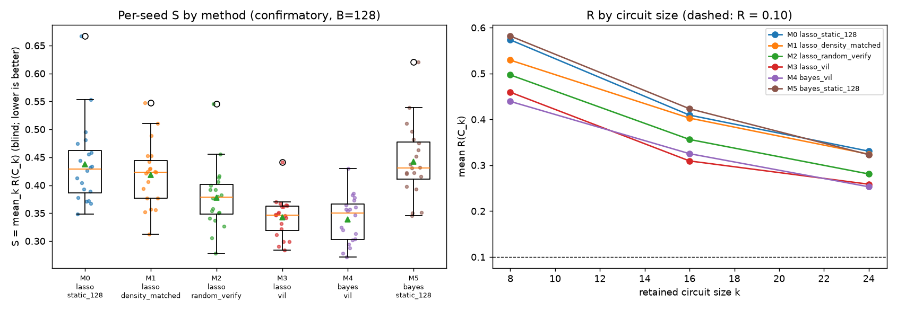
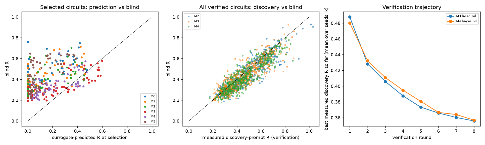
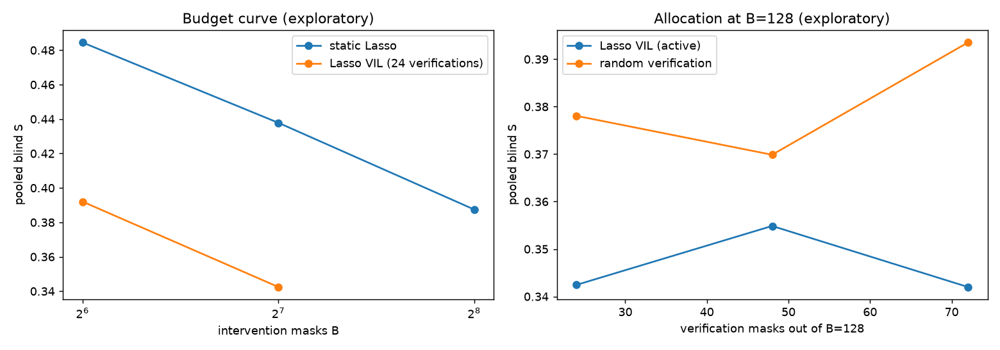

# BCCD-VIL-1.0 — generated results (2026-10-19T00:03:49Z)

## Development (exploratory; MIB dev evaluation prompts; never blind)

| method | mean dev S | 49001 | 49002 | 49003 | 49004 | 49005 | 49006 |
|---|---:|---:|---:|---:|---:|---:|---:|
| M0 lasso_static_128 | 0.4469 | 0.451 | 0.459 | 0.418 | 0.411 | 0.499 | 0.444 |
| M1 lasso_density_matched | 0.4258 | 0.479 | 0.339 | 0.427 | 0.407 | 0.500 | 0.403 |
| M2 lasso_random_verify | 0.4128 | 0.412 | 0.380 | 0.447 | 0.393 | 0.403 | 0.442 |
| M3 lasso_vil | 0.3739 | 0.381 | 0.387 | 0.356 | 0.345 | 0.380 | 0.395 |
| M4 bayes_vil | 0.3877 | 0.376 | 0.370 | 0.333 | 0.397 | 0.432 | 0.418 |
| M5 bayes_static_128 | 0.4312 | 0.403 | 0.370 | 0.385 | 0.497 | 0.474 | 0.460 |

Development schedule rule (prereg `decision.development_dependent_setting`): {"rounds8_lasso_vil": 0.37393848343856034, "rounds4_lasso_vil": 0.39322416088372925, "rounds4_bayes_vil": 0.382240048364548, "rounds8_bayes_vil": 0.3877330196216507, "rule_choice": 8}

## Confirmatory (20 seeds, blind 128 MIB test prompts)

**H1: PASS · H2: FAIL · recommendation: GO_VIL_WITHOUT_BAYES**

| code | method | pooled S | R k=8 | R k=16 | R k=24 | #R<=0.10 | surrogate@104 S | refit@128 S |
|---|---|---:|---:|---:|---:|---:|---:|---:|
| M0 | lasso_static_128 | 0.4378 | 0.5734 | 0.4094 | 0.3308 | 0/60 | — | — |
| M1 | lasso_density_matched | 0.4188 | 0.5292 | 0.4028 | 0.3243 | 0/60 | — | — |
| M2 | lasso_random_verify | 0.3781 | 0.4969 | 0.3562 | 0.2810 | 0/60 | 0.4484 | 0.4272 |
| M3 | lasso_vil | 0.3424 | 0.4593 | 0.3094 | 0.2587 | 0/60 | 0.4484 | 0.4097 |
| M4 | bayes_vil | 0.3392 | 0.4392 | 0.3253 | 0.2530 | 0/60 | 0.4553 | 0.4144 |
| M5 | bayes_static_128 | 0.4427 | 0.5817 | 0.4233 | 0.3231 | 0/60 | — | — |

| hypothesis | criterion | status | observed |
|---|---|---|---|
| H1 | V-1 | PASS | pooled S(lasso_vil)=0.3424 vs best non-verified lasso_density_matched 0.4188; ratio 0.818 (need <= 0.85) |
| H1 | V-2 | PASS | vs lasso_static_128: 90% CI of S_c - S_cand [+0.0659, +0.1292]; vs lasso_density_matched: 90% CI of S_c - S_cand [+0.0545, +0.1000]; vs bayes_static_128: 90% CI of S_c - S_cand [+0.0719, +0.1307] |
| H1 | V-3 | PASS | lasso_vil beats the seed-wise best non-verified method in 16/20 seeds (need >= 15) |
| H1 | V-4 | PASS | all methods x seeds: 128 logical masks (verifying 104+24), 0 reserved-mask queries, decisions sealed before evaluation |
| H2 | H2-1 | FAIL | pooled S(bayes_vil)=0.3392 vs S(lasso_vil)=0.3424; ratio 0.990 (need <= 0.9) |
| H2 | H2-2 | FAIL | 90% CI of S_lasso_vil - S_bayes_vil [-0.0169, +0.0232] |
| H2 | H2-3 | FAIL | bayes_vil < lasso_vil in 10/20 seeds (need >= 13) |

Secondary (never override primary):

- secondary_M3_vs_M2: ratio 0.906; 90% CI of S_ref - S_cand [+0.0123, +0.0605]; seed wins 14/20
- secondary_M4_vs_M2: ratio 0.897; 90% CI of S_ref - S_cand [+0.0236, +0.0544]; seed wins 17/20
- secondary_M2_vs_M0: ratio 0.863; 90% CI of S_ref - S_cand [+0.0371, +0.0870]; seed wins 18/20
- secondary_M1_vs_M0: ratio 0.956; 90% CI of S_ref - S_cand [-0.0102, +0.0466]; seed wins 14/20
- H1 criteria applied to bayes_vil (secondary, not adjudicated): PASS — pooled S(bayes_vil)=0.3392 vs best non-verified lasso_density_matched 0.4188; ratio 0.810 (need <= 0.85); vs lasso_static_128: 90% CI of S_c - S_cand [+0.0721, +0.1277]; vs lasso_density_matched: 90% CI of S_c - S_cand [+0.0583, +0.1007]; vs bayes_static_128: 90% CI of S_c - S_cand [+0.0809, +0.1258]; bayes_vil beats the seed-wise best non-verified method in 17/20 seeds (need >= 15)

Optimism (winner's curse) by method and role:

| method | role | n | pred_R_mean | R_disc_audit_mean | R_blind_mean | optimism_blind_minus_pred | optimism_disc_minus_pred | blind_minus_disc | corr_pred_blind | corr_disc_blind |
|---|---|---|---|---|---|---|---|---|---|---|
| bayes_static_128 | final | 60 | 0.1023 | 0.4771 | 0.4427 | 0.3403 | 0.3748 | -0.0345 | 0.628 | 0.9058 |
| bayes_vil | final | 60 | 0.1964 | 0.3568 | 0.3392 | 0.1428 | 0.1604 | -0.0177 | 0.7081 | 0.895 |
| bayes_vil | refit_128 | 60 | 0.2559 | 0.4325 | 0.4144 | 0.1584 | 0.1766 | -0.0181 | 0.4743 | 0.9102 |
| bayes_vil | surrogate_at_104 | 60 | 0.1139 | 0.4853 | 0.4553 | 0.3414 | 0.3714 | -0.03 | 0.7274 | 0.9184 |
| bayes_vil | verified | 480 | 0.1955 | 0.4689 | 0.4341 | 0.2386 | 0.2734 | -0.0348 | 0.6578 | 0.9007 |
| lasso_density_matched | final | 60 | 0.1322 | 0.4631 | 0.4188 | 0.2866 | 0.3309 | -0.0443 | 0.6742 | 0.9018 |
| lasso_random_verify | final | 60 | 0.1353 | 0.3907 | 0.3781 | 0.2428 | 0.2553 | -0.0126 | 0.6645 | 0.9114 |
| lasso_random_verify | refit_128 | 60 | 0.1989 | 0.4571 | 0.4272 | 0.2283 | 0.2582 | -0.0299 | 0.63 | 0.7847 |
| lasso_random_verify | surrogate_at_104 | 60 | 0.1183 | 0.4842 | 0.4484 | 0.3301 | 0.3659 | -0.0358 | 0.6216 | 0.8527 |
| lasso_random_verify | verified | 480 | 0.1346 | 0.4913 | 0.4579 | 0.3233 | 0.3567 | -0.0334 | 0.555 | 0.9019 |
| lasso_static_128 | final | 60 | 0.1269 | 0.4829 | 0.4378 | 0.3109 | 0.3559 | -0.0451 | 0.681 | 0.8741 |
| lasso_vil | final | 60 | 0.2584 | 0.3558 | 0.3424 | 0.0841 | 0.0974 | -0.0133 | 0.7722 | 0.8841 |
| lasso_vil | refit_128 | 60 | 0.304 | 0.4378 | 0.4097 | 0.1057 | 0.1338 | -0.0281 | 0.6761 | 0.8674 |
| lasso_vil | surrogate_at_104 | 60 | 0.1183 | 0.4842 | 0.4484 | 0.3301 | 0.3659 | -0.0358 | 0.6216 | 0.8527 |
| lasso_vil | verified | 480 | 0.243 | 0.4565 | 0.432 | 0.189 | 0.2135 | -0.0245 | 0.6016 | 0.8914 |

Bayesian circuit-level calibration: {"bayes_vil": {"n_circuits": 660, "coverage90_discovery_u": 0.47878787878787876, "by_role": {"final": 0.7666666666666667, "surrogate_at_104": 0.11666666666666667, "refit_128": 0.7333333333333333, "verified": 0.45625}, "mean_P_faithful": 0.4164242424242425, "n_claims_P_ge_0.95": 12, "n_invalid_claims_blind": 12, "frac_measured_above_hi90": 0.5212121212121212}, "bayes_static_128": {"n_circuits": 60, "coverage90_discovery_u": 0.08333333333333333, "by_role": {"final": 0.08333333333333333}, "mean_P_faithful": 0.6519999999999999, "n_claims_P_ge_0.95": 13, "n_invalid_claims_blind": 13, "frac_measured_above_hi90": 0.9166666666666666}}

Mean costs per method and seed:

| method | n_masks | n_discovery_masks | n_verification_masks | logical_prompt_evals | physical_mask_evals | cache_hits | logical_oracle_seconds | wall_fit | wall_search | wall_acquisition | cpu_fit | cpu_search | cpu_acquisition | wall_e2e_logical | wall_e2e_measured | wall_total_method | wall_diagnostic | peak_vram_mb |
|---|---|---|---|---|---|---|---|---|---|---|---|---|---|---|---|---|---|---|
| bayes_static_128 | 128.0 | 128.0 | 0.0 | 4096.0 | 0.0 | 128.0 | 11.042 | 1.666 | 0.051 | nan | 1.666 | 0.051 | nan | 12.759 | 1.719 | 1.72 | nan | 643.86 |
| bayes_vil | 128.0 | 104.0 | 24.0 | 4096.0 | 23.8 | 104.2 | 10.156 | 6.585 | 11.471 | 0.061 | 6.584 | 11.47 | 0.061 | 28.273 | 19.299 | 21.057 | 1.751 | 773.106 |
| lasso_density_matched | 128.0 | 128.0 | 0.0 | 4096.0 | 24.0 | 104.0 | 10.792 | 2.026 | 0.039 | nan | 2.025 | 0.039 | nan | 12.856 | 3.886 | 3.887 | nan | 1333.098 |
| lasso_random_verify | 128.0 | 104.0 | 24.0 | 4096.0 | 24.0 | 104.0 | 10.292 | 1.527 | 2.165 | 1.016 | 1.527 | 2.165 | 1.015 | 15.0 | 6.03 | 8.289 | 2.245 | 1333.098 |
| lasso_static_128 | 128.0 | 128.0 | 0.0 | 4096.0 | 128.0 | 0.0 | 11.042 | 2.159 | 0.04 | nan | 2.16 | 0.04 | nan | 13.241 | 13.242 | 13.243 | nan | 1336.255 |
| lasso_vil | 128.0 | 104.0 | 24.0 | 4096.0 | 23.0 | 105.0 | 9.998 | 16.279 | 7.388 | 0.005 | 16.279 | 7.388 | 0.005 | 33.67 | 24.654 | 27.034 | 2.377 | 773.106 |

## Bridge (pilot seeds 31001-31005; secondary)

| method | pooled S |
|---|---:|
| lasso_static_128 | 0.3848 |
| lasso_density_matched | 0.4152 |
| lasso_random_verify | 0.3824 |
| lasso_vil | 0.3346 |
| bayes_vil | 0.3663 |
| bayes_static_128 | 0.3674 |

lasso_static_128 reproduces pilot lasso_pair@128 circuits: {31001: True, 31002: True, 31003: True, 31004: True, 31005: True}

## EXPLORATORY (post-verdict): budget and allocation variants on the confirmatory seeds

Run after the H1/H2 verdicts were computed and committed; not preregistered; never overrides the primary analysis.

| config | method | budget | n_verify | n_seeds | pooled_S | R_k8 | R_k16 | R_k24 | n_R_le_0.10 |
|---|---|---|---|---|---|---|---|---|---|
| static Lasso, B=64 | lasso_static_128 | 64 | 0 | 20 | 0.4845 | 0.6398 | 0.4692 | 0.3445 | 0 |
| static Lasso, B=128 (M0) | lasso_static_128 | 128 | 0 | 20 | 0.4378 | 0.5734 | 0.4094 | 0.3308 | 0 |
| static Lasso, B=256 | lasso_static_128 | 256 | 0 | 20 | 0.3875 | 0.5245 | 0.3566 | 0.2813 | 0 |
| Lasso VIL, B=64 (40+24) | lasso_vil | 64 | 24 | 20 | 0.392 | 0.5338 | 0.3653 | 0.277 | 0 |
| Lasso VIL, B=128 (104+24) (M3) | lasso_vil | 128 | 24 | 20 | 0.3424 | 0.4593 | 0.3094 | 0.2587 | 0 |
| Lasso VIL, B=128 (80+48) | lasso_vil | 128 | 48 | 20 | 0.3549 | 0.4653 | 0.3281 | 0.2712 | 0 |
| Lasso VIL, B=128 (56+72) | lasso_vil | 128 | 72 | 20 | 0.342 | 0.445 | 0.32 | 0.261 | 0 |
| random verify, B=128 (104+24) (M2) | lasso_random_verify | 128 | 24 | 20 | 0.3781 | 0.4969 | 0.3562 | 0.281 | 0 |
| random verify, B=128 (80+48) | lasso_random_verify | 128 | 48 | 20 | 0.3699 | 0.4949 | 0.3446 | 0.2701 | 0 |
| random verify, B=128 (56+72) | lasso_random_verify | 128 | 72 | 20 | 0.3935 | 0.5387 | 0.359 | 0.2829 | 0 |

Paired comparisons (same seeds, blind prompts; 90% hierarchical bootstrap CI of S_ref - S_cand):

- Lasso VIL, B=64 (40+24) vs static Lasso, B=128 (M0): S 0.3920 vs 0.4378 (ratio 0.895); CI [+0.0199, +0.0753]; wins 14/20
- Lasso VIL, B=128 (104+24) (M3) vs static Lasso, B=256: S 0.3424 vs 0.3875 (ratio 0.884); CI [+0.0232, +0.0682]; wins 16/20
- static Lasso, B=256 vs static Lasso, B=128 (M0): S 0.3875 vs 0.4378 (ratio 0.885); CI [+0.0168, +0.0882]; wins 13/20
- Lasso VIL, B=128 (80+48) vs Lasso VIL, B=128 (104+24) (M3): S 0.3549 vs 0.3424 (ratio 1.036); CI [-0.0305, +0.0051]; wins 7/20
- Lasso VIL, B=128 (56+72) vs Lasso VIL, B=128 (104+24) (M3): S 0.3420 vs 0.3424 (ratio 0.999); CI [-0.0224, +0.0223]; wins 10/20
- Lasso VIL, B=128 (56+72) vs random verify, B=128 (56+72): S 0.3420 vs 0.3935 (ratio 0.869); CI [+0.0273, +0.0740]; wins 16/20

